# roub

[](https://github.com/janecekvit/roub/actions/workflows/ci.yml)
[](https://github.com/janecekvit/roub/actions/workflows/security.yml)
[](https://codecov.io/gh/janecekvit/roub)
[](https://scorecard.dev/viewer/?uri=github.com/janecekvit/roub)
[](LICENSE)

Server-centric version control for agent-scale monorepos.

*Roub* is Czech for *scion*: the shoot grafted onto a rootstock. roub follows the design Anthropic
described in [Redesigning source control at Anthropic](https://www.anthropic.com/research/redesigning-source-control).
It is an independent implementation, not affiliated with or endorsed by Anthropic.

> **Status:** early skeleton. The crates build and the wire contract is defined; no RPC is
> implemented yet. See [design decisions](docs/design/decisions.md) for what comes next.

## Why

Git gives every clone the full history so it can work offline. CI jobs and AI agents are online by
definition, check out the same monorepo millions of times a day and need only a slice of it. roub
moves the work to the server:

- **Clients are always online.** They fetch only the trees and blobs they need, by content address.
- **The server does the heavy lifting:** commits, merges, rebases, blame and history.
- **Commits take no lock.** A changeset is appended to a write-ahead log; only moving `main` is a
  compare-and-swap on one row.
- **Everything scales horizontally.** Objects never change, so any cache can answer any request.
- **The working copy is optional, and sparse by design.** Agents and CI can work through the API.

## Architecture



The diagram is rendered from [roub-architecture.d2](docs/architecture/roub-architecture.d2).
Sequence diagrams for a checkout and a commit are in [docs/architecture](docs/architecture/README.md).

| Crate | Binary | Role |
|---|---|---|
| `roub-core` | | Object ids (BLAKE3) and cross-platform path rules |
| `roub-proto` | | gRPC contract, generated with a vendored `protoc` |
| `roub-cli` | `roub` | Command-line client |
| `roubd` | `roubd` | Node daemon: shared object store, file watcher |
| `roub-cache` | `roub-cache` | Regional tree and blob cache |
| `roub-server` | `roub-server` | Authoritative API |

## Platforms

| | Linux (Debian) | Windows | Azure |
|---|---|---|---|
| Server, cache | container or `.deb` + systemd | Windows service | Container Apps or AKS |
| Daemon | systemd, Unix socket | Windows service, named pipe | build agents |
| Checkout | sparse, FUSE | sparse, ProjFS | sparse |
| Storage | PostgreSQL, filesystem or S3 | PostgreSQL, filesystem or S3 | Azure Database for PostgreSQL, Blob Storage |

## Build

Requires the Rust toolchain pinned in `rust-toolchain.toml`. No system `protoc` is needed.

```sh
cargo build --workspace
cargo test --workspace
cargo clippy --workspace --all-targets -- -D warnings
```

Run the server (every RPC currently answers `UNIMPLEMENTED`):

```sh
cargo run -p roub-server -- --listen 127.0.0.1:7470
```

Container image on Debian, and the local development stack (PostgreSQL, Azurite):

```sh
docker build -t roub-server .
docker compose up
```

## Security

Report vulnerabilities privately, as described in [SECURITY.md](SECURITY.md).

## License

Apache License 2.0. See [LICENSE](LICENSE) and [NOTICE](NOTICE).
