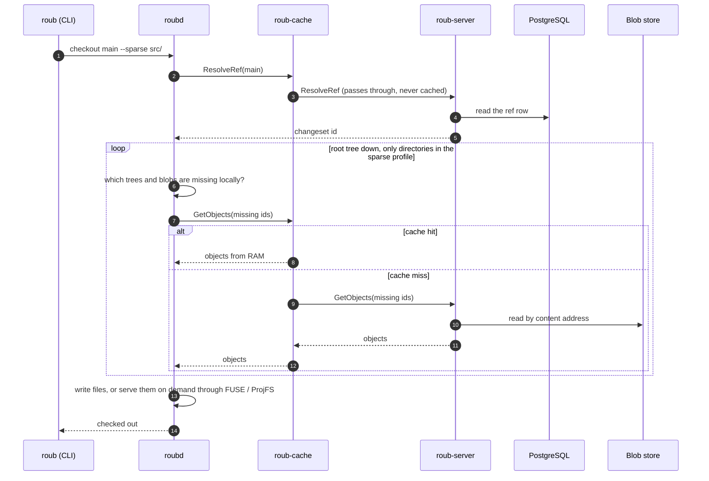
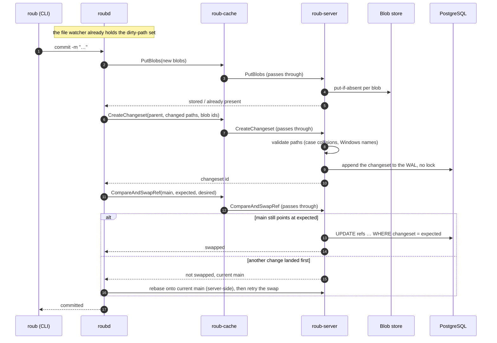

# Architecture

- **Tiers and boundaries:** [`roub-architecture.d2`](roub-architecture.d2) is the source of truth.
  It is written in [D2](https://d2lang.com) and rendered to
  [`roub-architecture.svg`](roub-architecture.svg) by `scripts/render-diagrams.sh`. CI fails when
  the SVG is out of date, the source is not formatted, or it does not compile.
- **Flows over time:** the Mermaid sequence diagrams below render directly on GitHub.

Update the D2 source and re-render in the same change whenever a component, boundary or flow
changes; update the sequence diagrams when an RPC or its order changes.

## Tiers

Blue edges are a checkout (1–6), orange edges a commit (7–11), grey dashed edges supporting paths.
Dashed containers are failure domains and deployment boundaries.

## Checkout

## Commit

